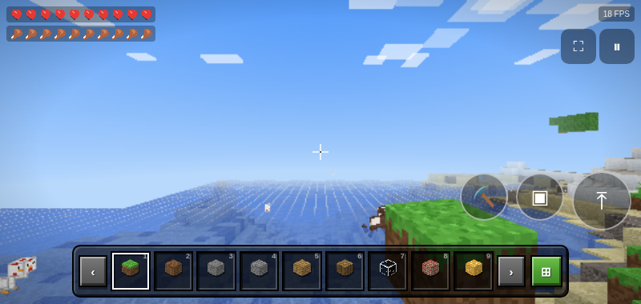
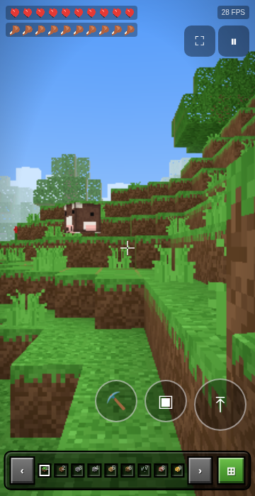

# 🎮 بلاک کرَفت — BlockCraft

بازی سبک‌وزن و آفلاین به سبک ماینکرافت برای اندروید — کاملاً بومی، بدون نیاز به اینترنت و **بدون هیچ دسترسی (permission)‌ای**.

| | |
|---|---|
| 📦 نسخه | 1.1 (واقعی — ساخت ۲۷ اکتبر) |
| 🤖 حداقل اندروید | 7.0 (API 24) |
| 💾 حجم | کمتر از ۱ مگابایت |
| 🔒 دسترسی‌ها | هیچ! |
| 🌐 اینترنت | لازم نیست — کاملاً آفلاین |

## 📲 دانلود و نصب

1. به بخش [**Releases**](https://github.com/sahandmarami/BlockCraft-Android/releases/latest) بروید و فایل `BlockCraft-v1.1.apk` را دانلود کنید.
2. روی فایل دانلودشده بزنید؛ اگر اندروید پرسید، اجازه‌ی «نصب از منابع ناشناس» را برای مرورگر خود فعال کنید.
3. نصب را تأیید کنید — تمام! آیکون BlockCraft به صفحه‌ی اصلی اضافه می‌شود.

> ⚠️ **مهم — ارتقا از نسخه‌های قبلی:** کلید امضای این نسخه عوض شده است. اگر نسخه‌ی قبلی را نصب دارید، اول آن را **حذف (uninstall)** کنید و بعد این نسخه را نصب کنید؛ وگرنه اندروید پیام «برنامه نصب نشد» می‌دهد. (دنیای ذخیره‌شده‌ی نسخه‌ی قبلی با حذف برنامه پاک می‌شود.)

## ✨ تازه‌های نسخه ۱.۱ — رفع باگ‌های اصلی

- 🐄 **حیوانات و ماب‌ها دیگر نیمه‌مدفن نمی‌شوند:** فیزیک سقوط آن‌ها زیرگام‌بندی شد؛ دیگر از کف زمین رد نمی‌شوند و اگر محبوس شوند خودکار بالا می‌آیند. سقوط از پرتگاه و کوه حالا درست کار می‌کند.
- 👆 **نگاه‌کردن دیگر بلوک نمی‌شکند:** قبلاً اگر انگشت‌تان هنگام چرخاندن دوربین روی صفحه می‌ماند، بازی شروع به خراب‌کردن بلوک‌ها می‌کرد! حالا فقط نگه‌داشتنِ **بی‌حرکت** انگشت بلوک را می‌شکند.
- ⛏️🧱 **دو دکمه‌ی جدید کندن و ساختن** (مثل کنترل‌های کلاسیک موبایل): ⛏ نگه‌دار = شکستن، ▣ = ساختن. دیگر لازم نیست حالت ضربه/نگه‌داشتن را حفظ باشید.
- 📊 **نوار بلوک‌ها (hotbar) در همه‌ی صفحه‌ها کامل جا می‌شود** — از صفحه‌های باریک تا لبه‌به‌لبه‌ی افقی؛ بدون به‌هم‌ریختگی و بدون پرش.
- 🖼️ **تکسچرها در دوردست تمیزتر:** نقشه‌ی بافت حالا mipmap دارد؛ دیگر در دوردست سوسو نمی‌زند و خراب دیده نمی‌شود.
- ⚡ **رزولوشن پویا واقعی شد:** اگر FPS پایین بیاید کیفیت خودکار کم و بعد برگردد — همیشه روان‌ترین حالت ممکن.
- 🔙 **دکمه‌ی برگشت گوشی** منوی توقف را باز می‌کند (دوبار = خروج).

## 🌍 امکانات بازی

- 🌍 دنیای بی‌کران رویه‌ای (Procedural) با بایوم‌های جنگل، دشت، بیابان و برفی
- ⛏️ شکستن و چیدن بیش از ۲۰ نوع بلوک با انیمیشن ترک و ذرات
- 🐑 حیوانات (گوسفند، گاو، خوک، مرغ) + زامبی‌های شب که با طلوع می‌سوزند
- ❤️ حالت **بقا**: جان، گرسنگی، شکار، غرق‌شدگی، آسیب سقوط و مرگ/تولد دوباره
- 🪓 حالت **خلاقانه**: پرواز آزاد و بی‌مرگی
- 🛏️ ساخت تخت و خوابیدن تا صبح (تعیین نقطه‌ی تولد دوباره)
- 🌙 چرخه‌ی کامل شبانه‌روز با آسمان پرستاره، ماه و غروب واقعی
- 🔊 افکت‌های صوتی، صدای محیط (پرنده‌ها، جیرجیرک شب، باد کویر) و موسیقی تولیدی
- 💾 ذخیره‌ی خودکار دنیا در حافظه‌ی دستگاه

## 🖼️ تصاویر

## ⚡ بهینه‌سازی اندروید

- رزولوشن رندر پویا: اگر FPS افت کند، کیفیت به‌صورت خودکار تنظیم می‌شود تا بازی همیشه روان بماند
- بارگذاری دومرحله‌ای: سریع وارد بازی می‌شوید، بقیه‌ی دنیا در پس‌زمینه ساخته می‌شود
- پرش خودکار از پله‌ها، محافظت از خطای GPU و بازیابی خودکار

## 🛠️ ساخت از سورس (اختیاری)

کل بازی یک خروجی استاتیک Next.js/Three.js است که در `assets/www` داخل APK قرار می‌گیرد. اسکریپت `scripts/build_apk.sh` (در پروژه‌ی اصلی) بدون Gradle با aapt2 + d8 + apksigner بیلد می‌کند.

> این بازی ساخته‌ی طرفدارهاست و به گوگل‌پلی وصل نیست؛ برای همین نصب مستقیم APK لازم است. تمام گرافیک و صداها به‌صورت رویه‌ای تولید می‌شوند و هیچ دارایی‌ای از بازی‌های تجاری استفاده نشده است.
